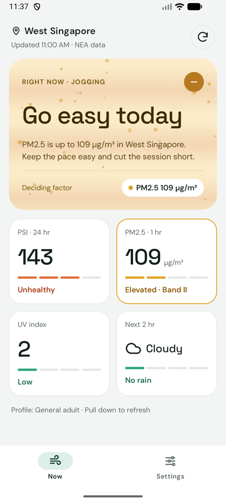
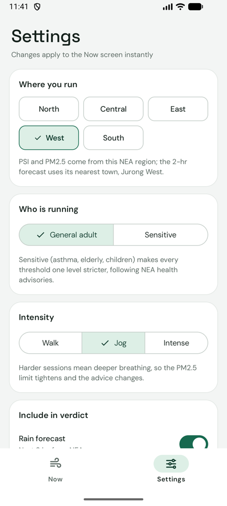
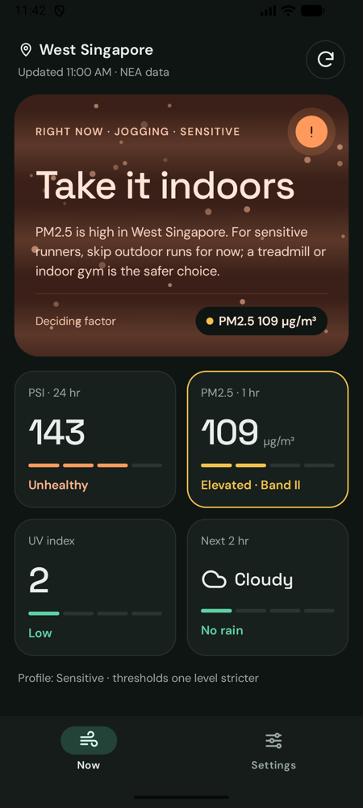

# Air Run

**CP3406 Assessment 1 – Utility App** · Kotlin · Jetpack Compose · Material 3

Repository: [zazylfs-sys/CP3406-AirRun](https://github.com/zazylfs-sys/CP3406-AirRun)

Air Run answers one question at a glance: **is the air OK for my run right now?**

Singapore's haze, hourly PM2.5 swings, strong UV and sudden thundery showers all affect
whether an outdoor run is a good idea. Air Run combines four live National Environment
Agency (NEA) feeds into **one verdict**: *Good to run*, *Go easy today* or *Take it indoors*.
It also names the factor that decided it. The verdict is tuned to who is running and how hard.

| Now (clear-ish air, general adult) | Settings | Now (dark theme, sensitive runner) |
|---|---|---|
|  |  |  |

*Screenshots are live data from 14 Oct 2026, a haze morning (PSI 143, PM2.5 109 µg/m³ in the west).*

---

## Core features

### Now screen (main utility)
| Element | What it tells you at a glance |
|---|---|
| **Verdict card** | One big answer, a one-sentence reason, and a *deciding factor* chip (e.g. "PM2.5 109 µg/m³"). The card colour moves from green to amber to clay as conditions get worse |
| **Living background** | Animated air particles drawn on a `Canvas`. Their density follows PM2.5, so a haze day *looks* hazy. Clear days get a soft sun glow, and rain verdicts show falling streaks |
| **Four tiles** | PSI (24 h), PM2.5 (1 h), UV index and the 2-hour forecast. Each has an official band label and a 4-segment level bar. The deciding factor's tile is outlined |
| **Freshness** | "Updated 11:00 AM · NEA data". Pull down or tap ⟳ to refresh. Readings are also refetched when you return to the app after 15 min |
| **Resilience** | If a refresh fails, the last readings stay with a short notice. If UV or forecast feeds are down, the verdict still works from PSI and PM2.5 |

### Settings screen
Settings are kept in memory only (the spec says they don't need to persist). Every change is applied to the Now screen **instantly, without another network call**.

| Setting | Effect on the Now screen |
|---|---|
| **Where you run**: North / Central / East / West / South | Which NEA region's PSI and PM2.5 are used. The 2-hour forecast comes from the **nearest town**, worked out by haversine distance from NEA's own location metadata (e.g. West → Jurong West) |
| **Who is running**: General adult / Sensitive | Sensitive (asthma, elderly, children) makes every air threshold one band stricter, following NEA health advisories |
| **Intensity**: Walk / Jog / Intense | Harder sessions mean deeper breathing, so the PM2.5 limit tightens by one band (and relaxes by one for a walk) |
| **Include in verdict**: Rain forecast, UV index | Exclude a factor, e.g. UV for an evening run. Its tile greys out and shows "Not in verdict" |

---

## How the verdict works (`domain/RunAdvisor.kt`)

Each factor gets a **severity** on one continuous scale: `< 1` OK, `1–2` caution, `≥ 2` avoid.
The verdict is the worst included factor. Because the scale is continuous, the factor *closest* to
a limit can still be shown as the deciding factor on a good day.

| Factor | Scale used | Rule |
|---|---|---|
| PSI (24 h) | NEA bands: Good ≤ 50, Moderate ≤ 100, Unhealthy ≤ 200, Very unhealthy ≤ 300, Hazardous | ≤ 100 OK, 101–200 caution, > 200 avoid. Sensitive shifts one band stricter |
| PM2.5 (1 h) | NEA bands I–IV: ≤ 55, ≤ 150, ≤ 250, > 250 µg/m³ | Band I OK, II caution, III+ avoid for a jog. ±1 band for walk / intense, +1 for sensitive |
| UV index | WHO: Low, Moderate, High, Very high (8+), Extreme | Caution from 8. Never forces indoors, since sunscreen and timing deal with it. A sunscreen tip is added from 3 |
| Rain | NEA 2-hour forecast text | Showers / rain: caution (slippery paths). Thundery: avoid (lightning) |

---

## Web APIs (Retrofit + kotlinx.serialization)

All four come from NEA's real-time API on data.gov.sg (`https://api-open.data.gov.sg/v2/real-time/api/`). No API key is needed.

| Endpoint | Used for | Update rate |
|---|---|---|
| `psi` | `psi_twenty_four_hourly` per region | hourly |
| `pm25` | `pm25_one_hourly` per region | hourly |
| `uv` | latest hourly UV index (island-wide) | hourly, 7 AM–7 PM |
| `two-hr-forecast` | forecast text for ~47 towns + their coordinates | every 30 min |

**How the APIs are used**
- **Parallel requests.** One refresh launches all four calls together with `async`, so it takes about as long as the slowest call.
- **One fetch serves every setting.** Each response covers all regions, so changing region, profile or intensity just recombines the cached readings in the ViewModel.
- **Graceful degradation.** Each feed fails independently. Only losing *both* PSI and PM2.5 counts as an error.
- **Robust parsing.** `ignoreUnknownKeys` and nullable DTOs throughout. The forecast field accepts both the plain-string and the `{code, text}` object shapes NEA uses.

---

## Architecture

```
MainActivity ─ AirRunApp (Scaffold + NavigationBar from the starter template)
   ├─ NowScreen ─────────┐            ui/screens, ui/components (VerdictCard, MetricTile,
   └─ SettingsScreen ────┤             AirAtmosphere, LevelBar, SettingsControls …)
                         ▼
               AirRunViewModel  ── StateFlow<NowUiState>, StateFlow<RunSettings>
                 │        │          combine(readings, settings) → RunAdvisor
                 ▼        ▼
 AirQualityRepository   SettingsRepository        (data/repository)
 (NetworkAirQuality…)   (in-memory StateFlow)
                 │
              NeaApi (Retrofit) → NeaMapper → AirReadings      (data/remote, data/model)

 domain/ — pure Kotlin: AirScales (NEA/WHO bands), RunAdvisor, RegionalConditions (nearest town)
 di/AppContainer — manual dependency injection, created once in AirRunApplication
```

- **MVVM + Repository + manual DI** (Week 4). The ViewModel gets its repositories through `viewModelFactory { initializer { … } }` from the application's `AppContainer`, and tests pass in fakes.
- **Unidirectional data flow.** Screens are stateless composables that take state plus callbacks (`NowScreen(uiState, onRefresh)`, `SettingsScreen(settings, SettingsActions)`), which makes them previewable and testable.
- **Lifecycle-aware.** It uses `collectAsStateWithLifecycle`, `SharingStarted.WhileSubscribed(5 s)` and `LifecycleEventEffect(ON_RESUME)` for stale-data refreshes.

### Jetpack Compose & Material 3 highlights
- Custom M3 theme with light and dark schemes from the mockup. Dynamic colour is off on purpose, because green vs. orange carries meaning. Extra semantic colours are provided through a `CompositionLocal` (`AirRunTheme.colors`).
- Bundled **DM Sans** and **Space Grotesk** fonts.
- `PullToRefreshBox`, `SingleChoiceSegmentedButtonRow`, `NavigationBar`, `Switch`, `OutlinedIconButton`.
- Animations: `AnimatedContent` (verdict headline), `animateColorAsState` (card colour), `rememberInfiniteTransition` (particles, badge "sonar" ring, refresh spinner), `Animatable` (level bars growing in). Particles are drawn from the draw phase only, so they don't cause recomposition. All decorative motion stops when the system "Remove animations" setting is on.
- Reusable, slot-based components: `MetricTile(value = { … })`, `SettingsSection { … }`, generic `ChoiceGrid<T>` / `SegmentedChoice<T>`.
- Accessibility: headings, merged tile semantics, a polite live region on the verdict, `selectable`/`toggleable` rows with proper roles, 44 dp+ touch targets.
- `@Preview`s for clear-day, haze-day (dark), error and settings states (`ui/PreviewData.kt`).

---

## Testing

| Suite | What it covers |
|---|---|
| `AirScalesTest` | NEA PSI / PM2.5 and WHO UV band edges, forecast-text classification |
| `RunAdvisorTest` | Both mockup scenarios, sensitive profile, intensity, rain/thunder, UV cap, excluded and missing factors |
| `RegionalConditionsTest` | Region → nearest forecast town, haversine distance |
| `NeaMapperTest` | Parses **real NEA responses** saved in `app/src/test/resources/nea/` |
| `NetworkAirQualityRepositoryTest` | Partial-failure handling with a fake `NeaApi` |
| `AirRunViewModelTest` | Loading → ready / error, failed refresh keeps data, settings recompute without refetching, 15-min staleness |
| `NowScreenTest`, `AirRunAppTest` (instrumented) | Compose UI: verdict text, tiles, retry; end-to-end settings → Now updates with a fake repository |

```bash
./gradlew testDebugUnitTest            # 39 JVM unit tests
./gradlew connectedDebugAndroidTest    # 6 Compose UI tests (emulator/device)
```

See [submission verification](docs/submission-verification.md) for the checks performed on 20 October 2026 and their limits.

---

## Getting started
1. Open the project in Android Studio (Ladybug or newer). No API keys are needed.
2. Run on an emulator or device with API 26+ and internet access.

> **Google Drive note.** Google Drive adds hidden `Icon\r` files to every folder, and the Android
> resource compiler rejects them. If the project is inside a Drive folder, the build
> removes those files from `src/` and puts build output in `~/.gradle/outside-drive-builds/`
> (see `build.gradle.kts`). Elsewhere, the standard `build/` folders are used.

## Week-by-week concepts

| Week | Concept | Where |
|---|---|---|
| 1 | Kotlin, Android Studio | whole project |
| 2 | Compose layouts | `ui/screens`, `ui/components` |
| 3 | Material Design 3 | `ui/theme`, M3 components above |
| 4 | ViewModel, DI, Repository | `AirRunViewModel`, `di/AppContainer`, `data/repository` |
| 5 | Web APIs with Retrofit | `data/remote/NeaApi`, `NetworkAirQualityRepository` |

## Credits
- Data: National Environment Agency, via [data.gov.sg](https://data.gov.sg) (Singapore Open Data Licence).
- Fonts: DM Sans and Space Grotesk, from Google Fonts (SIL Open Font License).
- Icons: traced from the Air Run UI mockup. Extra weather glyphs are adapted from [Lucide](https://lucide.dev) (ISC licence).
- Licence texts: [DM Sans](docs/licenses/DM-Sans-OFL.txt), [Space Grotesk](docs/licenses/Space-Grotesk-OFL.txt), and [Lucide](docs/licenses/Lucide-LICENSE.txt).
